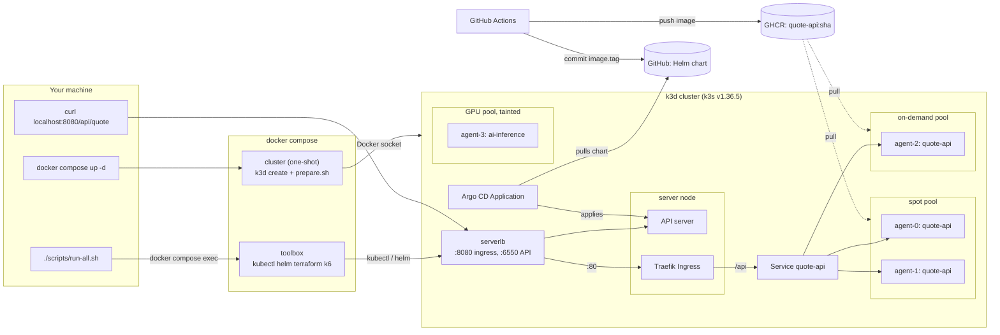

# quote-platform

Go quote API on a local 5-node k3d cluster with simulated spot, on-demand and GPU nodepools, deployed by Argo CD.

- Image: `ghcr.io/quaghug/quote-api:<git sha>` (amd64 + arm64, signed). Deployed tag: [`values.yaml`](charts/quote-api/values.yaml).
- Toolbox: `ghcr.io/quaghug/quote-toolbox:<git sha>`.

## Quick start

```bash
git clone https://github.com/QuagHug/quote-platform && cd quote-platform
docker compose up -d       # cluster + nodepools + toolbox (~2 min)
./scripts/run-all.sh       # all tasks (~15-20 min)
curl http://localhost:8080/api/quote
```

Needs Docker (~10 GB memory) and internet. Argo CD: <http://localhost:8081>. Grafana: <http://localhost:3000>. Teardown: `./scripts/down.sh`.

## Architecture



- `docker compose up -d` creates the k3d cluster through the Docker socket, runs the provided `prepare.sh`, then starts the toolbox.
- Requests: `localhost:8080` → k3d load balancer → Traefik → Service → pod.
- Delivery: CI pushes the image and commits its SHA to `values.yaml`; Argo CD pulls. CI never touches the cluster.
- AWS version: [docs/aws-production.md](docs/aws-production.md).

## Scripts

Each runs inside the toolbox and is safe to re-run.

| Script | Does |
|---|---|
| `00-bootstrap.sh` | Create cluster, run `prepare.sh`, pin Traefik (run by compose) |
| `10-cluster-info.sh` | Show nodes, pool labels, taints |
| `20-deploy.sh` | Install Argo CD, deploy the app, curl via Ingress |
| `25-reclaim-drill.sh` | Drain a spot node under a curl loop, then uncordon |
| `30-troubleshoot.sh` | Apply `fixed-app.yaml`, run `verify.sh` |
| `50-validate-tf.sh` | Terraform + kubeconform validation |
| `60-loadtest.sh` | Prometheus/Grafana, k6, HPA + placement evidence |
| `run-all.sh` / `down.sh` | Run 10-60 / tear everything down |

## Parts

| Part | Where |
|---|---|
| 1 App | [`app/`](app) |
| 2 GitOps | [`charts/quote-api/`](charts/quote-api), [`argocd/`](argocd) |
| 3 Troubleshooting | [`troubleshoot/fixed-app.yaml`](troubleshoot/fixed-app.yaml), [TROUBLESHOOTING.md](TROUBLESHOOTING.md) |
| 4 CI | [`ci.yml`](.github/workflows/ci.yml), [MIGRATION-NOTES.md](MIGRATION-NOTES.md) |
| 5 IaC | [`iac/`](iac) |
| 6 Load test | [`loadtest/`](loadtest), [LOADTEST.md](LOADTEST.md), [`docs/evidence/`](docs/evidence) |
| 7 Ops | [OPS-ANSWERS.md](OPS-ANSWERS.md) |
| AI | [AI-USAGE.md](AI-USAGE.md) |

## Design decisions

- **Placement** ([deployment.yaml](charts/quote-api/templates/deployment.yaml)):
  - Required: spot or on-demand only (excludes GPU and the unlabeled k3s server).
  - Preferred: spot.
  - Hard spread across pools, `maxSkew: 2`: 3 replicas can't split 3-0, so one is always on on-demand.
  - Soft spread across nodes: a hard one leaves a drained pod Pending.
- **PDB `maxUnavailable: 1`**: drains evict one pod at a time.
- **HPA scale-down 1 pod/min**: a fast drop deletes from the busiest node, the on-demand one, first.
- **k3d** (brief's recommendation): nodes live outside compose, so teardown is `down.sh`.
- **Go**: goroutines keep health checks responsive while requests burn CPU. Readiness fails before shutdown, so drains drop no requests.
- **Traefik pinned to the server node**, which the drill never drains.
- **No secrets**: anonymous local UIs; the legacy file's example AWS keys are redacted.

**Cut:** tracing, Alertmanager, offline Git mirror, descheduler, and the two-Deployment on-demand anchor (exact floor, but breaks "HPA min 3").

## Issues found in the provided files

1. `broken-app.yaml`: 11 layered faults ([TROUBLESHOOTING.md](TROUBLESHOOTING.md)).
2. `verify.sh` passes without the DNS rule on k3s (policy lands seconds late on new pods).
3. `prepare.sh` assigns roles by name order and would label kind's control-plane as spot.
4. The k3s server is a schedulable node with no pool label.
5. `legacy.gitlab-ci.yml` has AWS-key-shaped strings and a 404 image (`bitnami/kubectl:1.24`).

## Troubleshooting

- **Port busy:** run `./scripts/down.sh`, then `INGRESS_PORT=18080 docker compose up -d` (also `API_PORT`, `GRAFANA_PORT`, `ARGOCD_PORT`).
- **OOM or slow load test:** give Docker ~10 GB. Each k3d node reports the whole VM, so the scheduler can't see the shortage.
- **Linux:** the toolbox reaches the cluster via `host-gateway`; allow the Docker bridge through the host firewall.
