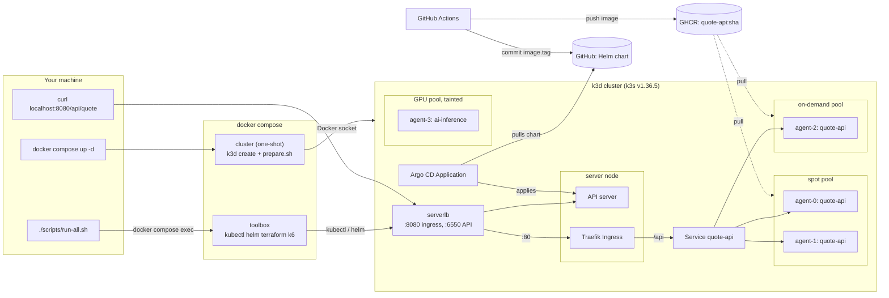

# quote-platform

A Go quote API on a local 5-node k3d cluster that imitates production nodepools: two **spot** nodes, one **on-demand** node and one tainted **GPU** node. Argo CD deploys it from this repo. Replicas prefer spot, at least one always runs on on-demand, and a drill proves it survives a spot reclaim.

- App image: `ghcr.io/quaghug/quote-api:<git sha>` (amd64 + arm64, cosign-signed). The running tag is `image.tag` in [`charts/quote-api/values.yaml`](charts/quote-api/values.yaml).
- Toolbox image: `ghcr.io/quaghug/quote-toolbox:<git sha>`, pinned in `docker-compose.yml`.

## Quick start

```bash
git clone https://github.com/QuagHug/quote-platform && cd quote-platform
docker compose up -d       # 5-node cluster + nodepool labels/taints + toolbox (~2 min)
./scripts/run-all.sh       # every task in order (~20 min)
curl http://localhost:8080/api/quote
```

Needs Docker with about 10 GB of memory and internet access. Nothing else on the host: each script re-runs itself inside the toolbox container. Argo CD: <http://localhost:8081>. Grafana: <http://localhost:3000> (dashboard `quote-api`). Both open without a login. Teardown: `./scripts/down.sh`.

## Architecture



- `docker compose up -d` runs k3d through the Docker socket (1 server, 4 agents), runs the provided `prepare.sh`, then starts the toolbox. When it returns, the cluster is ready.
- Requests go from `localhost:8080` through k3d's load balancer and Traefik to the `quote-api` Service.
- CI never touches the cluster. It pushes an image tagged with the commit SHA and commits that tag; Argo CD pulls it.
- Production version on AWS: [docs/aws-production.md](docs/aws-production.md).

## Scripts

| Script | What it does |
|---|---|
| `00-bootstrap.sh` | Creates or restarts the cluster, runs `prepare.sh`, pins Traefik to the server. Run by `docker compose up -d`. |
| `10-cluster-info.sh` | Nodes with pool labels and taints. |
| `20-deploy.sh` | Installs Argo CD, registers the app, waits for Synced/Healthy, curls through the Ingress. |
| `25-reclaim-drill.sh` | Curl loop, drains a spot node, shows pods moving, uncordons. Fails if over 1% of requests fail or on-demand is lost. |
| `30-troubleshoot.sh` | Applies `troubleshoot/fixed-app.yaml`, runs `verify.sh`. |
| `50-validate-tf.sh` | Terraform fmt/init/validate (Cloudflare) and kubeconform (Karpenter). |
| `60-loadtest.sh` | Prometheus + Grafana, k6 through the Ingress, records HPA scale-out and placement. |
| `run-all.sh` | Runs 10 to 60 in order. |
| `down.sh` | Deletes the cluster and the compose project. |

## Where each part is

| Part | Files |
|---|---|
| 1 App | [`app/`](app) |
| 2 GitOps + placement | [`charts/quote-api/`](charts/quote-api), [`argocd/`](argocd), [`docs/evidence/`](docs/evidence) |
| 3 Troubleshooting | [`troubleshoot/fixed-app.yaml`](troubleshoot/fixed-app.yaml), [`TROUBLESHOOTING.md`](TROUBLESHOOTING.md) |
| 4 CI migration | [`.github/workflows/ci.yml`](.github/workflows/ci.yml), [`MIGRATION-NOTES.md`](MIGRATION-NOTES.md) |
| 5 Karpenter + Cloudflare | [`iac/`](iac) |
| 6 Load test | [`loadtest/k6/`](loadtest/k6), [`monitoring/`](monitoring), [`LOADTEST.md`](LOADTEST.md) |
| 7 Ops questions | [`OPS-ANSWERS.md`](OPS-ANSWERS.md) |
| AI usage | [`AI-USAGE.md`](AI-USAGE.md) |

## Design decisions

- **Placement** ([deployment.yaml](charts/quote-api/templates/deployment.yaml)):
  - A required affinity keeps pods on the spot and on-demand pools. That excludes the GPU node and the unlabeled k3s server.
  - A preferred affinity favors spot.
  - A hard spread across pools (`maxSkew: 2`) forces at least 1 of 3 replicas onto on-demand.
  - The per-node spread is soft. A hard one would leave the drained pod Pending, because a cordoned node still counts as an empty domain.
- **PDB `maxUnavailable: 1`**, so a drain evicts one pod at a time.
- **HPA scale-down limited to 1 pod per minute.** The default can drop 10 replicas to 3 at once, and the ReplicaSet deletes from the busiest node first, which is the on-demand node.
- **The floor is enforced at scheduling only.** The exact-floor production pattern is two Deployments: an on-demand anchor plus an elastic spot set. It is documented, not built, because it bends the "HPA min 3" spec.
- **k3d via the Docker socket**, as the brief recommends. Its nodes live outside compose, so teardown is `down.sh`. The toolbox reaches the API through `host.docker.internal`, which works on Mac and Linux.
- **Go**, because each request gets its own goroutine and health checks stay responsive while requests burn CPU. Readiness flips to 503 on SIGTERM before shutdown, so the drill sees zero errors.
- **The chart omits `spec.replicas` when the HPA is on**, so Argo CD and the HPA don't fight over it. The ServiceMonitor and PrometheusRule render only once their CRDs exist.
- **Traefik is pinned to the server node**, which the drill never drains.
- **No secrets.** Grafana and Argo CD use anonymous local access. The example AWS keys in the legacy CI file were redacted.
- **Cut:** OpenTelemetry tracing, Alertmanager (the rule evaluates in Prometheus), an offline Git mirror, and a descheduler.

## Problems found in the provided files

1. `broken-app.yaml` has 11 layered faults ([TROUBLESHOOTING.md](TROUBLESHOOTING.md)).
2. `verify.sh` passes even without the DNS egress rule on k3s, because kube-router enforces policy on new pods a few seconds late.
3. `prepare.sh` picks roles by node-name order and would label kind's control-plane node as spot.
4. The k3s server is a schedulable fifth node with no pool label.
5. The legacy CI file contains AWS-key-shaped strings (redacted here), and its `bitnami/kubectl:1.24` image no longer exists.

## Troubleshooting on your machine

- **Port in use:** set `INGRESS_PORT`, `API_PORT`, `GRAFANA_PORT` or `ARGOCD_PORT` before `docker compose up -d`, after running `./scripts/down.sh`.
- **Pods OOMKilled or the machine crawls during the load test:** give Docker about 10 GB of memory. Every k3d node reports the whole VM as its own, so the scheduler can't see the shortage.
- **Apple Silicon or x86:** all images are multi-arch. On Apple Silicon, efficiency cores make latency less even (see LOADTEST.md).
- **Linux:** the toolbox reaches the cluster via `host-gateway`. A firewall blocking the Docker bridge from host ports breaks this.
