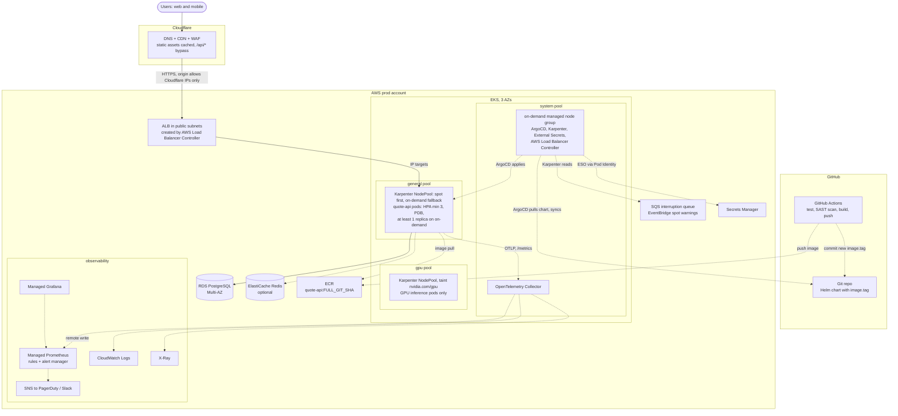

# quote-api on AWS (bonus)

The same patterns as the local harness, on EKS. Solid arrows are request and data paths; dotted arrows are control, delivery and telemetry.

- **Edge:** Cloudflare (Terraform, Part 5b) caches static assets and passes `/api/*` through. The ALB accepts only Cloudflare IP ranges, and everything else sits in private subnets across 3 AZs.
- **Nodes:** a small on-demand node group runs the controllers, since Karpenter should not run on nodes it manages. A Karpenter general pool prefers spot; the GPU pool is tainted and follows Part 5a. quote-api keeps the local placement: prefer spot, at least one replica on on-demand, soft spread, PDB.
- **Spot reclaims:** EventBridge puts the 2-minute warning on SQS and Karpenter drains the node before AWS takes it, so nobody is paged (OPS-ANSWERS Q2).
- **Delivery:** CI pushes a full-SHA image to ECR and commits the tag; ArgoCD syncs it, so CI never touches the cluster. ECR replaces GHCR in production for IAM pulls with no registry credentials.
- **Data and secrets:** RDS PostgreSQL Multi-AZ; ElastiCache only if reads need caching. ESO syncs from Secrets Manager using Pod Identity (OPS-ANSWERS Q4).
- **Observability and cost:** an OpenTelemetry Collector sends metrics to Managed Prometheus (alerts via SNS, its only receiver), logs to CloudWatch and traces to X-Ray. Self-hosted kube-prometheus-stack with Loki and Tempo is cheaper at small scale. EKS costs $0.10 per cluster-hour ($0.60 on extended support); VPC endpoints keep image pulls off NAT.
